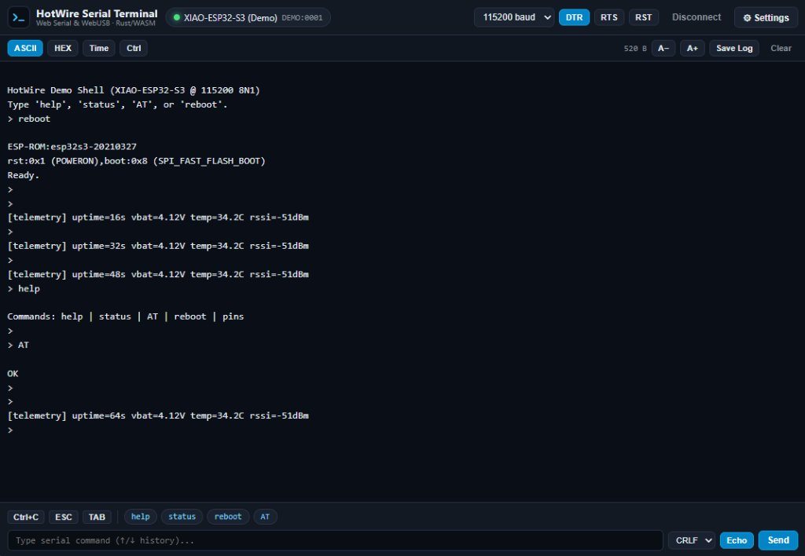

# HotWire Serial Terminal — Cross-Platform Web Serial & WebUSB PWA

[](https://github.com/kavierim/HotWire-Serial-Terminal/actions/workflows/deploy.yml)
[](https://kavierim.github.io/HotWire-Serial-Terminal/)
[](https://developer.mozilla.org/en-US/docs/Web/API/WebUSB_API)
[](https://developer.mozilla.org/en-US/docs/Web/API/Web_Serial_API)
[](https://leptos.dev/)

A zero-install, offline-capable Progressive Web App (PWA) USB Serial Terminal built with **Rust + WebAssembly** ([Leptos](https://leptos.dev/) CSR + [Trunk](https://trunkrs.dev/)) for both **Desktop PCs** and **Android mobile devices**.

> **Try it in 1 click (no hardware required):** Open **[https://kavierim.github.io/HotWire-Serial-Terminal/](https://kavierim.github.io/HotWire-Serial-Terminal/)** and click **Demo** to test the interactive ESP32-S3 serial shell.



## Transport & Bridge Support
* **Direct USB Mode (PC & Android):**
  * **Desktop (Chrome, Edge, Brave on Windows / macOS / Linux / ChromeOS):** Uses **Web Serial API** (`navigator.serial`) by default for native OS serial drivers, with optional **WebUSB** (`navigator.usb`) fallback.
  * **Mobile (Chrome / Edge on Android 8+):** Automatically uses **WebUSB API** (`navigator.usb`) with built-in user-space drivers (`CDC-ACM`, `FTDI`, `Silicon Labs CP210x`, `QinHeng CH340/CH341/CH9102`, `Prolific PL2303`).
* **XIAO ESP32 UART Bridge Mode (`D6 / D7`, 3.3 V TTL):**
  * Turns a **Seeed Studio XIAO ESP32-S3** (`D6 / GPIO 43` TX, `D7 / GPIO 44` RX) or **XIAO ESP32-C6** (`D6 / GPIO 16` TX, `D7 / GPIO 17` RX) into a dedicated hardware USB-to-UART bridge for probing external embedded targets.
  * Includes a **built-in Web Flasher** (`⚡ Flasher` in the top bar) with pre-compiled firmware binaries for both boards, plus software **Swap TX/RX (`D6 ↔ D7`)** and **Invert RX / TX** options in `⚙ Settings`.
  * **Firmware Sketches:**
    * [`firmware/HotWire_UART_XIAO_ESP32S3/HotWire_UART_XIAO_ESP32S3.ino`](firmware/HotWire_UART_XIAO_ESP32S3/HotWire_UART_XIAO_ESP32S3.ino)
    * [`firmware/HotWire_UART_XIAO_ESP32C6/HotWire_UART_XIAO_ESP32C6.ino`](firmware/HotWire_UART_XIAO_ESP32C6/HotWire_UART_XIAO_ESP32C6.ino)
* **Demo Mode:**
  * Simulated `ESP32-S3 Demo` firmware shell works offline on any browser (including devices without USB hardware).

## Key Features
* **Authorized Auto-Reconnect & Smart Defaults:** Reconnects previously granted USB devices via `getPorts()` / `getDevices()`, applies per-`VID:PID` DTR/RTS profiles (`DTR=ON` for native USB CDC-ACM, `DTR=OFF` for external UART bridges), and supports `100ms` MCU reset pulses (`RST`) plus multi-port switching (`[P0 / P1]`).
* **Dual-Buffer Engine:** 10,000-chunk / 2 MB `RingBuffer` keeps raw `Uint8Array` payloads and millisecond timestamps for instant, non-destructive switching between `ASCII`, `HEX`, `Timestamps`, and `Invisible Chars`.
* **xterm.js Terminal Viewport:** Hardware-accelerated ANSI/VT100 rendering, two-finger pinch-to-zoom (`9px`–`24px`) on mobile + `Ctrl+Wheel` / `-` / `+` zoom on desktop, and Smart Auto-Scroll Lock (`↓ Resume`).
* **Mobile Ergonomics:** Dedicated `TAB`, `↑`, `↓`, `Ctrl+C`, `ESC` keys, customizable macro chips (long-press or right-click to edit), `CRLF`/`LF`/`CR`/`RAW` selector, Local Echo, Screen Wake Lock while connected, and `visualViewport` keyboard avoidance.

## HotWire Ecosystem
* **[HotWire Serial Terminal](https://github.com/kavierim/HotWire-Serial-Terminal)** ([Live App](https://kavierim.github.io/HotWire-Serial-Terminal/)) — Cross-platform Web Serial & WebUSB terminal for desktop and Android
* **[HotWire Oscilloscope](https://github.com/kavierim/HotWire-Oscilloscope)** ([Live App](https://kavierim.github.io/HotWire-Oscilloscope/)) — 4-Channel 12-bit GDMA ADC Oscilloscope & FFT Spectrum Analyzer
* **[HotWire Logic Analyzer](https://github.com/kavierim/HotWire-Logic-Analyzer)** ([Live App](https://kavierim.github.io/HotWire-Logic-Analyzer/)) — 8-Channel Logic Analyzer & Tri-State Force I/O with UART/SPI/I²C decoders
* **[HotWire SDR](https://github.com/kavierim/HotWire-SDR)** ([Live App](https://kavierim.github.io/HotWire-SDR/)) — 1.84–2.79 GHz RF Spectrum Analyzer, Wideband Scanner & Waterfall for XIAO ESP32-S3 & XIAO ESP32-C6

## Development

Built with **Rust + WebAssembly** ([Leptos](https://leptos.dev/) CSR + [Trunk](https://trunkrs.dev/)).

```bash
rustup target add wasm32-unknown-unknown
cargo clippy --all-targets -- -D warnings
cargo test
trunk serve          # local dev server (http://127.0.0.1:8082)
trunk build --release
```

> **Note:** Browsers require a secure context (`https://` or `http://localhost`) for Web Serial and WebUSB hardware access.

## License

Copyright © 2026 Kari Vierimaa, Kempele — Licensed under the [Apache License 2.0](LICENSE).
